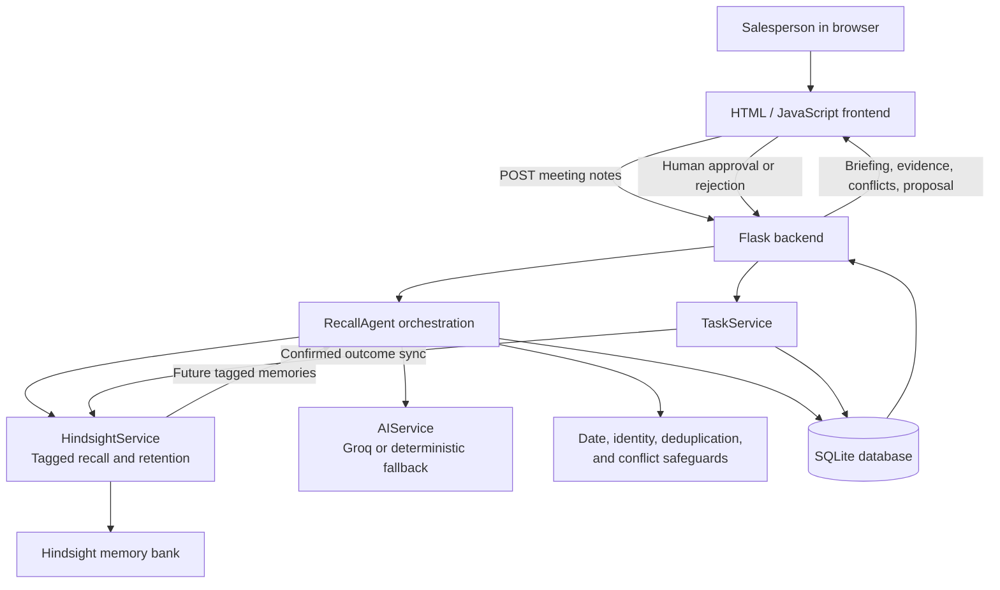

# Recall Architecture

## Main flow

1. The frontend submits meeting notes to Flask.
2. `RecallAgent` identifies the prospect and retrieves only tagged memories for that prospect.
3. The AI service analyzes the notes and retrieved history. Python safeguards validate dates, evidence, lifecycle states, and conflicts.
4. SQLite stores structured customer state and pending proposals.
5. A human approves or rejects a proposal. Only approval can create a task.
6. A confirmed outcome is saved in SQLite first, then synchronized to Hindsight when available.
7. The next meeting can recall that outcome through the same prospect tag.

SQLite is the local operational record. Hindsight is the long-term memory layer. Groq is optional; the application has a deterministic fallback for unavailable or invalid model responses.

